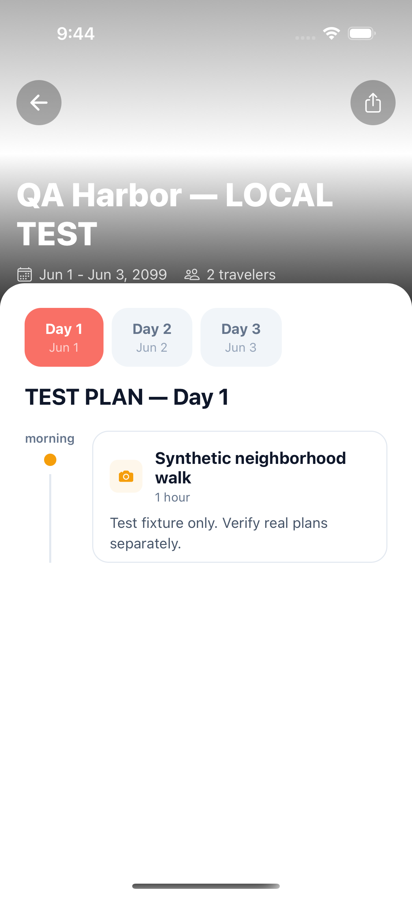

# Local mobile integration harness — October 20, 2026

Implemented local email login using real Supabase Auth, two disposable accounts,
and deterministic itinerary generation. Mobile never receives the service-role
key. Production mobile configuration/release checks reject the test flag; runtime
login requires a development bundle and loopback API/Auth URLs. Fixture generation
fails closed outside local development and retains normal route authentication,
trip ownership and the generation-fencing RPC.

The isolated launcher copies current source without dotenv files, installs the
frozen lockfile with Bun's hoisted linker, and starts the actual Next.js backend
and Expo app. It does not deploy code or contact hosted Supabase. Source changes
require a launcher restart. Local services remain available for review.

## Verified

- All 654 mobile tests pass (61 suites).
- All 18 targeted web generation/fixture tests pass (3 suites).
- Mobile and web TypeScript checks pass; changed application files pass ESLint.
- Mobile release environment check rejects `EXPO_PUBLIC_TEST_LOGIN=true`.
- Real email/password sessions authenticate both synthetic users.
- Guest access is rejected. A second user's private-trip read and generation
  request are rejected by the API; direct Data API reads return no foreign rows.
- Actual trip creation, fixture generation and saved itinerary reads pass through
  the real application API and local database.
- Native iOS 18.5 / Expo Go email sign-in succeeds. My Trips loads the saved
  synthetic trip and native itinerary rendering shows all three date tabs and
  the synthetic activity. The full cold-start → email login → My Trips → saved
  itinerary Maestro flow passes.
- Success, terminal failure, uncertain timeout, superseded generation and invalid
  environment guards have targeted coverage. Failure/timeout UI acceptance is
  separate from these unit checks.

Initial Maestro runs exposed selector mismatches (tabs include their position),
the iOS Save Password prompt and cached Expo bundles. The flow now cold-starts,
uses tab accessibility labels and declines password storage. The local login
layout handles the keyboard and guards stale callbacks and duplicate presses.

## Limits

This proves local Auth/API/database integration and native login/saved-plan
rendering. It does not establish Apple/Google OAuth, streaming, real AI output,
real supplier behavior, push delivery, Android/physical-device acceptance, or a
complete native create/edit/share/sign-out suite. Fixture generation runs
synchronously and mobile observes it through the real polling route; real durable
workflow dispatch is deliberately outside this harness.

No model/provider spend, production mutation or deployment occurred. See the
[repeatable commands and scenario guide](../mobile-testing.md).
