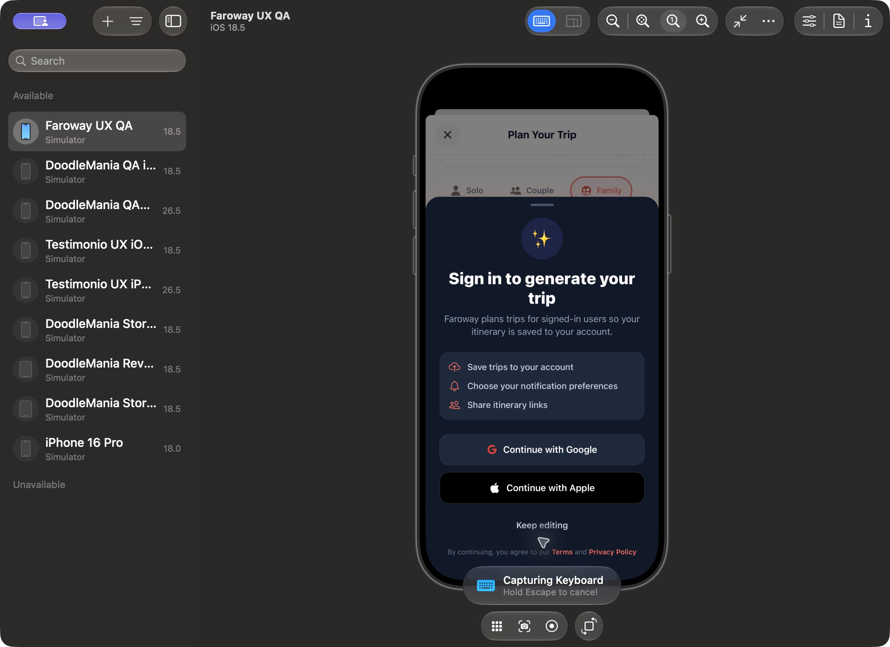
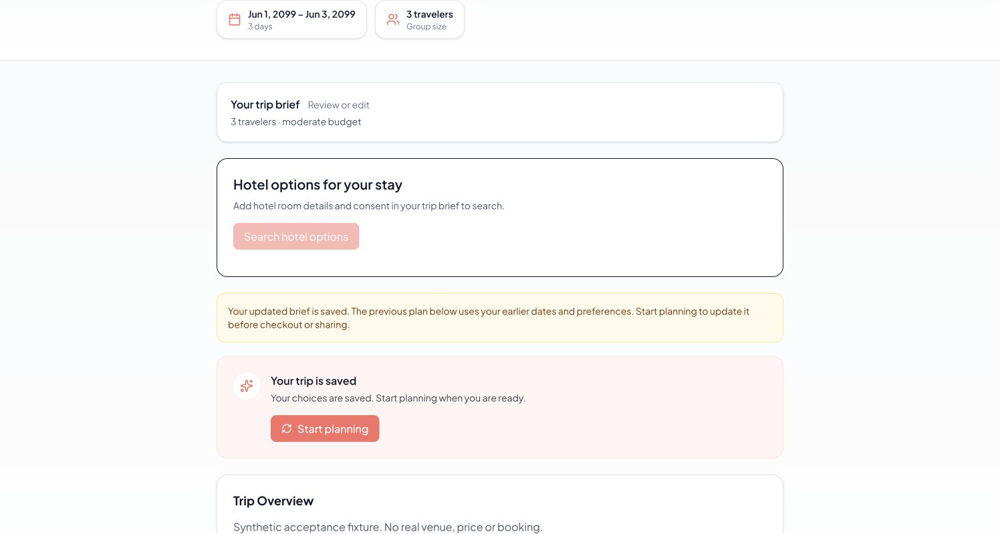
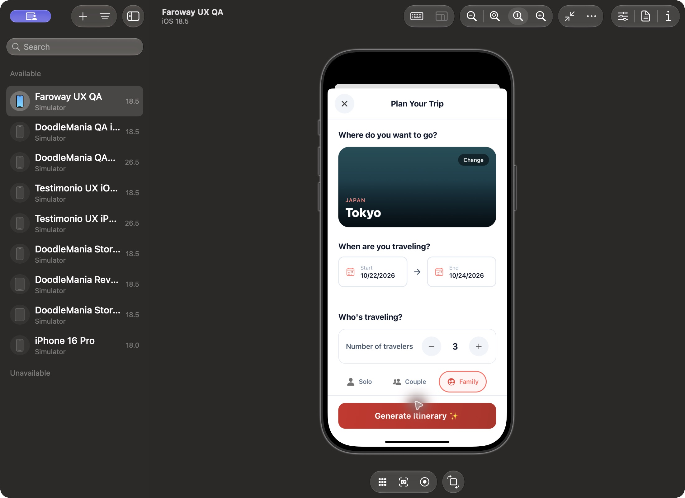

# Staging and native acceptance — 2026-10-20

## Scope and version boundaries

Mobile is the priority. Tested the native React Native app in Expo Go 54.0.7 on
Faroway UX QA, iOS 18.5 simulator, using local mobile source from base `9384d24`.
Metro uses the staging Supabase project `omovikloadpvzijoaqus` and staging API alias.
This is not a signed release build, physical-device test, Android test or native
OAuth/push acceptance.

The authenticated browser session used
`https://faroway-git-codex-release-candidate-testimonio.vercel.app`, which serves
commit `e6bc774e41fe7a13c036aed117badbfb9ca313b3` (deployment
`dpl_BSYkZ5tBBn9wQjtkeVq45TrMUW87`). These observations do not verify the current
local fixes or the newer preview at `668a312048e183c366d94d75445ad2237b60119b`.

## Native observations

- Cold launch, onboarding Get Started and guest Explore navigation worked.
- Tokyo selection opened the native planner with that destination selected.
- Missing dates disabled generation. Start October 22 and end October 24, 2026
  persisted after closing the date pickers. Earlier dates were disabled.
- Family selection and increment to three travelers worked.
- Culture selection visibly updated the checkbox and count to 1/5.
- Guest Generate opened “Sign in to generate your trip”, offering Google/Apple.
  Keep editing dismissed the gate and retained Tokyo, both dates, three travelers,
  Family and the interest selection.
- No new search or trip was dispatched by that guest action. Source also returns
  at the authentication gate before issuing generation requests.

Authenticated native acceptance is blocked: staging's public Auth settings report
Google and Apple disabled, email enabled; mobile exposes Google/Apple login and
no email login. Expo Go also cannot establish acceptance for the native Google
module. Configure intended staging OAuth providers/redirects and use a signed
development build before testing login, session restoration and authenticated
creation/generation. Do not add a production auth bypass to solve this.

## Authenticated staging browser observations

A disposable synthetic planned trip was seeded through the staging connector;
this establishes fixture setup, not acceptance of app-driven trip creation.

- Owner read rendered the saved itinerary with unknown prices.
- Keep private left sharing off. Creating a public link set sharing/token; its
  public renderer displayed the synthetic plan. This used the same browser
  session, so it does not prove a guest-without-session read.
- Revoking sharing cleared the token and the old link displayed unavailable/404.
  Network HTTP status was not captured.
- Editing two to three travelers saved the new brief, marked the plan stale and
  retained the old itinerary. A stale tab's conflicting destination edit was
  rejected without overwriting the saved data; Load latest brief recovered it.
- Sharing/revoking also changed the revision; existing tabs needed refresh before
  editing. The conflict warning prevented lost updates.
- Reading another account's private trip page displayed 404 without its contents.
- Direct API navigation was blocked by the browser client, so API status,
  unauthorized mutation and deletion acceptance are not claimed.
- Desktop OS sharing handoff did not complete; the UI warned that its link was
  still active. No native OS-sharing acceptance is claimed.

The synthetic trip and its itinerary were removed through the staging connector.
Verified four original trips remain and zero fixture trips/itineraries remain.
No paid model calls, purchases, production mutations or deployments occurred.

Maestro independently verified three travelers, the 1/5 interest count and the
sign-in gate. Its exact `Tokyo` scroll selector timed out and its `Keep editing`
text selector was absent from the accessibility hierarchy despite the visible
button. Both attempted flows failed; no full Maestro pass is claimed. Recovery
was completed through Device Hub coordinates and visually verified, including
Tokyo, both dates and three travelers. Add stable native accessibility identifiers
for this sheet before relying on repeatable automated acceptance.

## Next acceptance gates

1. Deploy the verified candidate to staging and record the exact source SHA.
2. Enable intended staging native OAuth and create a signed development build.
3. Test login, interrupted auth recovery, session restoration, guest brief handoff,
   authenticated generation, retry/timeout, saved-trip reopen/edit/share/revoke on
   iOS and Android; include one physical device and poor connectivity.
4. Run a bounded real AI sample only after confirming provider billing/budget.
   Sandbox naming does not establish that model inference is free.
5. Apply the [AI evaluation strategy](../ai-evaluation-strategy.md), starting with
   hard requirement propagation before model/prompt comparisons.
